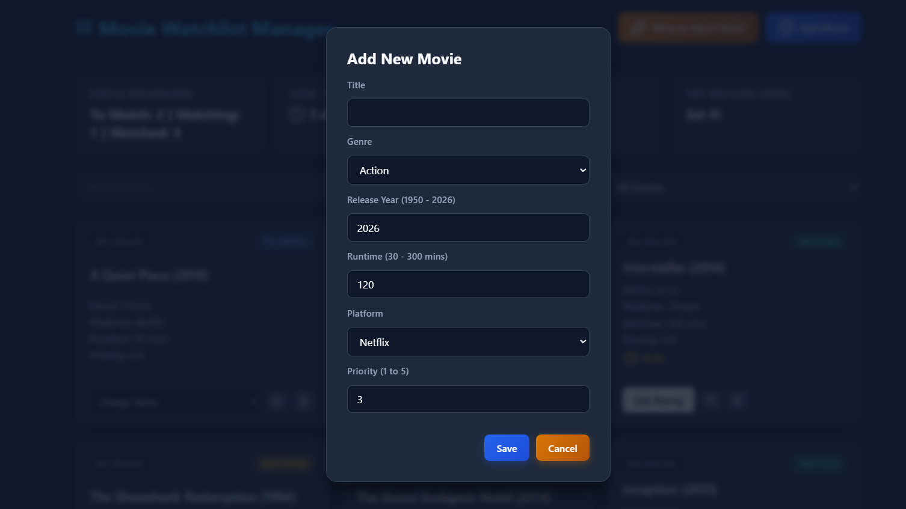

# 🎬 Movie Watchlist Manager (MERN Stack)

A full-stack Movie Watchlist Manager web application built for the MERN stack exam. It allows movie enthusiasts to plan what to watch, track progress, manage ratings, view statistics, and ensure strict status/validation workflows.

---

## 🛠️ Tech Stack
- **Frontend:** React.js, Lucide Icons, Custom CSS (Cinema Dark Dashboard Theme)
- **Backend:** Node.js, Express.js
- **Database:** MongoDB Atlas (Mongoose)

---

## 🔌 API Endpoints Created

| Method | Endpoint | Description |
| :--- | :--- | :--- |
| **GET** | `/api/movies` | Get all movies (supports filtering by status/genre, title search, pagination, and sorting) |
| **POST** | `/api/movies` | Add a new movie with server-side validations & auto-generated movie code |
| **PUT** | `/api/movies/:id` | Update movie details or transition status (with strict workflow & rating checks) |
| **DELETE** | `/api/movies/:id` | Delete a movie (restricted if status is `Watching`) |
| **GET** | `/api/movies/watch-next` | Get the recommended highest-priority `To Watch` movie |
| **GET** | `/api/movies/stats` | Get dashboard aggregations (status counts, hours watched, average rating, top genre) |

---

## 📸 Application Screenshots

## 📸 Application Screenshots

### 1. Dashboard & Statistics Overview
.png)

### 2. Movie Watchlist & Management

*(Note: You can use the same image or add a second one named `screenshot2.png` if you took two different views!)*

---

## 🚀 Getting Started Locally

1. Clone the repository:
   ```bash
   git clone [https://github.com/Devika-KJ/movie-watchlist-app.git](https://github.com/Devika-KJ/movie-watchlist-app.git)